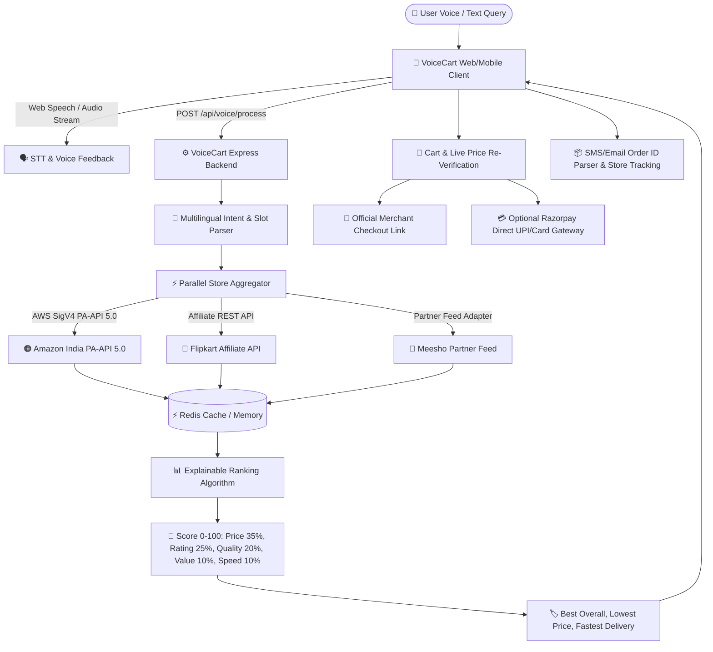

# 🎙️ VoiceCart — Multi-Store AI Voice Shopping Assistant

> **Production-grade voice-controlled shopping comparison app comparing live products across Amazon India, Flipkart, and Meesho.**

---

## 🌟 System Overview & Architecture

VoiceCart empowers users to speak natural voice shopping queries (e.g. *"Find me the best wireless earbuds under 2000 rupees"*, or in Hindi *"2000 रुपये के अंदर सबसे अच्छे ईयरबड्स दिखाओ"*, or Tamil *"2000 ரூபாய்க்குள் சிறந்த இயர்பட்ஸ் காட்டு"*).

The system performs:
1. **Speech-to-Text & Intent Slot Parsing** (Product, Brand, Max Budget, Preference).
2. **Parallel Live API Fetching** across Amazon India (PA-API 5.0) and Flipkart Affiliate API with Meesho Partner Adapter.
3. **Multi-Factor Explainable Ranking Algorithm** (0–100 composite score based on Bayesian-weighted ratings, price, delivery speed, and return policies).
4. **Side-by-Side 3-Store Comparison Matrix**.
5. **Real-time Cart & Live Price Re-Verification**.
6. **Official Store Deep-Link Purchasing & SMS/Email Order Timeline Tracking**.



---

## 🚀 Key Features

- **Push-to-Talk Voice Interface**: Live audio waveform visualization, multilingual support (English, Hindi, Tamil) with real-time speech recognition and text-to-speech spoken summaries.
- **Strict Real Data Compliance**: Zero mock or fake product data. Uses official signed AWS SigV4 Amazon PA-API 5.0 and Flipkart Affiliate API.
- **Compliant Meesho Adapter**: Strictly avoids web scraping. If partner credentials are not configured, cleanly reports *"Meesho: Partner API Required"* in the UI.
- **Explainable Ranking**: Dynamic scoring model weighting Price (35%), Bayesian-smoothed ratings (25%), Quality signals (20%), Value per unit (10%), and Delivery speed (10%).
- **Cross-Store Comparison Matrix**: Live price, shipping fee, delivery timeline, and return policy comparison across Amazon, Flipkart, and Meesho.
- **Cart with Live Price Re-Verification**: Re-queries the live store APIs before checkout to alert users if prices have dropped or increased.
- **SMS / Email Confirmation Order Tracker**: Automatically extracts Store and Order IDs from confirmation texts (e.g. Amazon `402-1234567-8901234`, Flipkart `OD1234567890`) and generates direct links to official store tracking pages.
- **In-App Direct Checkout (Razorpay)**: Server-side Razorpay order generation and HMAC signature verification for direct sales.

---

## 🔑 Official API Keys & Registration Setup

All credentials must be placed in `.env` in the root folder.

### 1. Amazon India Product Advertising API 5.0 (PA-API 5.0)
1. Register for the Amazon Associates program in India: [https://affiliate-program.amazon.in/](https://affiliate-program.amazon.in/).
2. Maintain an active Associate tag (e.g., `voicecart0a-21`).
3. In the Associates Central dashboard, navigate to **Tools** ➔ **Product Advertising API**.
4. Click **Add Credentials** to generate your `Access Key ID` and `Secret Access Key`.
5. Add to `.env`:
   ```env
   AMAZON_ACCESS_KEY=your_access_key
   AMAZON_SECRET_KEY=your_secret_key
   AMAZON_ASSOCIATE_TAG=voicecart0a-21
   ```

### 2. Flipkart Affiliate API
1. Register at the Flipkart Affiliate Portal: [https://affiliate.flipkart.com/](https://affiliate.flipkart.com/).
2. Go to **Affiliate Tools** ➔ **API Credentials**.
3. Copy your `Affiliate ID` and `Affiliate Token`.
4. Add to `.env`:
   ```env
   FLIPKART_AFFILIATE_ID=your_flipkart_affiliate_id
   FLIPKART_AFFILIATE_TOKEN=your_flipkart_affiliate_token
   ```

### 3. Meesho Partner API
- **Policy Notice**: Meesho does not currently provide an open public self-serve developer portal for affiliates.
- **Implementation**: VoiceCart provides a clean adapter `MeeshoProvider`. If you are an enterprise partner with an official supplier feed or partner API, set:
  ```env
  MEESHO_PARTNER_API_KEY=your_partner_token
  MEESHO_PARTNER_ENDPOINT=https://your-partner-endpoint.meesho.com/v1/feed
  ```
- If unconfigured, VoiceCart displays *"Meesho: Partner API Required"* without scraping or inserting mock data.

### 4. Razorpay Payment Gateway (Live & Test Modes)

VoiceCart supports direct in-app checkout for VoiceCart own-store products with automatic UPI-first ordering.

#### Switching Between Test and Live Modes:
Control the environment using ONLY the `PAYMENT_MODE` variable in `.env`:

```env
# --- TEST MODE ---
PAYMENT_MODE=test
RAZORPAY_KEY_ID=rzp_test_...
RAZORPAY_KEY_SECRET=...
RAZORPAY_WEBHOOK_SECRET=...

# --- LIVE PRODUCTION MODE ---
# PAYMENT_MODE=live
# RAZORPAY_KEY_ID=rzp_live_...
# RAZORPAY_KEY_SECRET=...
# RAZORPAY_WEBHOOK_SECRET=...
```

> **Security Guard**: When `PAYMENT_MODE=live`, the server refuses to boot unless `RAZORPAY_KEY_ID` begins with `rzp_live_` and `RAZORPAY_KEY_SECRET` is configured. `RAZORPAY_KEY_SECRET` is never logged or exposed to the frontend.

---

## ✅ Production Go-Live Checklist for Real Razorpay Payments

Before switching `PAYMENT_MODE=live` in production, ensure all requirements below are completed:

1. **KYC & Account Activation**:
   - Complete KYC submission and bank account verification on the [Razorpay Dashboard](https://dashboard.razorpay.com/).
   - Ensure the account status shows **Active / Live**.

2. **Deployed HTTPS Domain**:
   - Deploy your frontend and backend on secure HTTPS domains (e.g. `https://your-domain.com`). Razorpay Live Checkout requires valid SSL certificates.

3. **Mandatory Compliance & Policy Pages**:
   - Publish the following pages linked in your website footer as required by RBI / Razorpay merchant onboarding:
     - **Terms & Conditions**
     - **Privacy Policy**
     - **Refund & Cancellation Policy** (VoiceCart includes instant refund API endpoints `/api/payments/refund`)
     - **Contact Us** (with phone number and business address)

4. **Live API Credentials**:
   - Under **Account & Settings** ➔ **API Keys**, generate your **Live Key ID** (`rzp_live_...`) and **Live Key Secret**.
   - Set in `.env`:
     ```env
     PAYMENT_MODE=live
     RAZORPAY_KEY_ID=rzp_live_your_live_key_id
     RAZORPAY_KEY_SECRET=your_live_key_secret
     ```

5. **Webhook Configuration**:
   - In Razorpay Dashboard, navigate to **Settings** ➔ **Webhooks** ➔ **Add New Webhook**.
   - **Webhook URL**: `https://your-domain.com/api/payments/webhook`
   - **Secret**: Generate a strong random secret and add as `RAZORPAY_WEBHOOK_SECRET` in `.env`.
   - **Active Events**: Check `payment.captured`, `payment.failed`, and `order.paid`.

6. **Payment Methods Activation**:
   - Enable payment methods under **Settings** ➔ **Payment Methods**:
     - **UPI**: Google Pay, PhonePe, Paytm, BHIM, Cred, and Dynamic QR.
     - **Cards**: Visa, Mastercard, RuPay, Diners Club.
     - **Netbanking**: All major Indian banks.
     - **Wallets**: Mobikwik, Freecharge, etc.

7. **Partner Store Order Guard**:
   - VoiceCart strictly restricts Razorpay payments to items with `ownStore=true`.
   - Items from Amazon, Flipkart, and Meesho are never processed through Razorpay and always direct users to official merchant affiliate links.

---

## 🛠️ Step-by-Step Installation & Running

### Prerequisites
- Node.js (v18 or higher)
- npm or yarn
- (Optional) Redis and PostgreSQL (in-memory fallbacks are included for immediate zero-config operation)

### 1. Clone & Configure Environment
```bash
cp .env.example .env
# Edit .env and insert your API keys
```

### 2. Install & Start Backend
```bash
cd backend
npm install
npm run dev
```
Backend will start at `http://localhost:5000` with API health endpoint at `http://localhost:5000/health`.

### 3. Install & Start Frontend
```bash
cd ../frontend
npm install
npm run dev
```
Frontend will start at `http://localhost:5173`.

---

## 🧪 Running Unit & Integration Tests

Run the test suite in the `backend/` directory:

```bash
cd backend
npm test
```

### Test Coverage includes:
- `tests/rankingEngine.test.ts`: Validates Bayesian score weighting, budget filtering, and badges generation.
- `tests/providers.test.ts`: Verifies store adapter interfaces and Meesho scraping-free compliance.
- `tests/intentParser.test.ts`: Tests English, Hindi, and Tamil intent extraction, budget extraction, and slot parsing.
- `tests/cartAndOrder.test.ts`: Tests cart persistence, live price delta checks, and SMS regex order parsing.

---

## 📋 Compliant Alternatives for Non-Official Features

| Feature | Non-Official / Prohibited Method | VoiceCart's Compliant Alternative |
|---|---|---|
| **Meesho Product Feed** | HTML scraping / headless browser scraping | Strict partner interface (`MeeshoProvider`). If no partner API credentials exist in `.env`, displays *"Meesho: Partner API Required"* in UI without fake data. |
| **Store Checkout** | Automated login / credit card filling scraping | Official Affiliate Deep Linking. Directs users safely to Amazon/Flipkart mobile apps or web pages where users authenticate with their own credentials. |
| **Order Status Tracking** | Scraping user's private store login accounts | Safe SMS / Email confirmation text parser with direct official store tracking links (`amazon.in/gp/your-account/order-details`, `flipkart.com/account/orders`). |
